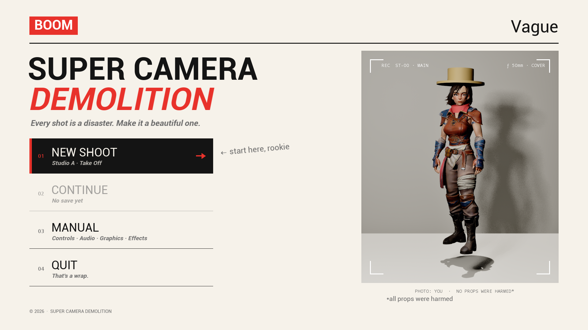
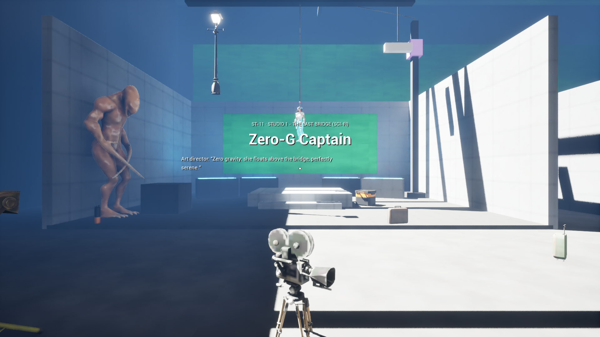
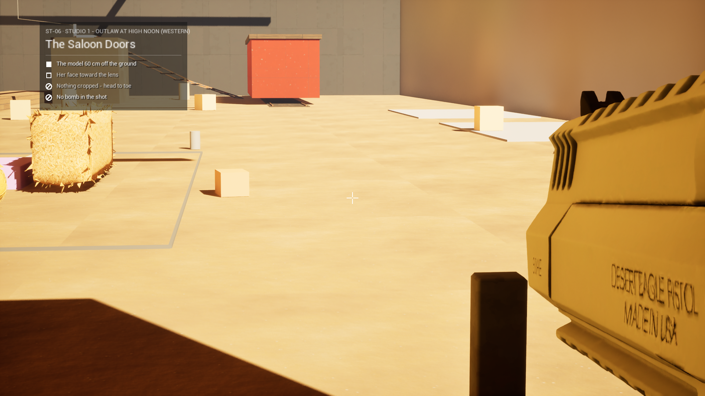
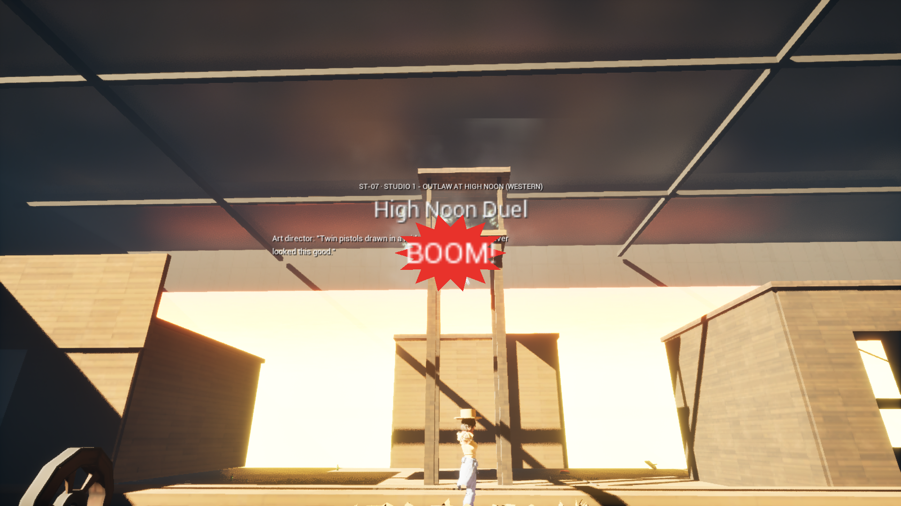
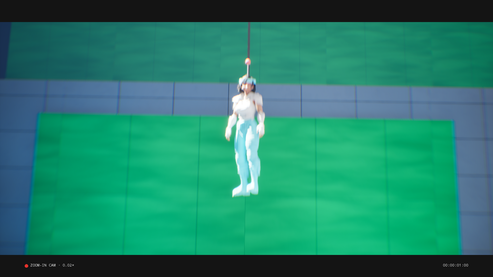
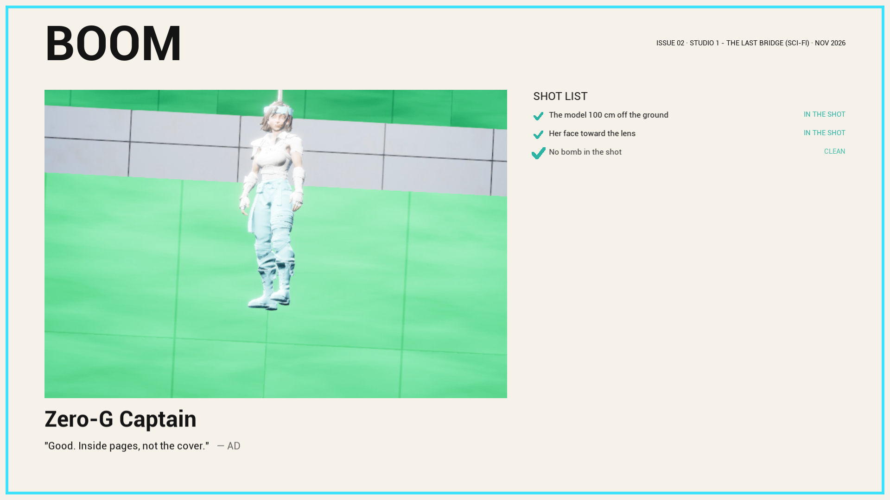
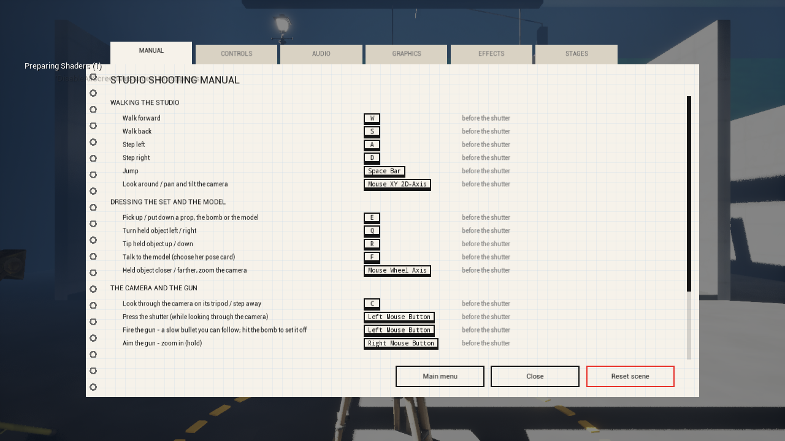

# SUPER CAMERA DEMOLITION

> **"폭발 직전의 1초를, 세상에서 가장 완벽한 화보로 만들어라."**
> *Every shot is a disaster. Make it a beautiful one.*



| 항목 | 내용 |
|---|---|
| 장르 | 물리 상호작용 기반 코미디 · 퍼즐 · 샌드박스 |
| 엔진 | Unreal Engine 5.8 |
| 플랫폼 | Windows (PC) |
| 시점 | 1인칭 |
| 분량 | 스튜디오 3곳 (서부극 · SF · 로맨스), 스테이지 20개 |

---

## 게임 소개

플레이어는 패션 잡지 「**BOOM**」의 포토그래퍼다. 이 잡지의 화보가 전설인 이유는 단 하나, **스튜디오에 시한폭탄이 있기 때문**이다.

스테이지마다 아트 디렉터(AD)가 화보 콘셉트를 주문한다. 플레이어는 제한 시간 안에 소품을 옮기고, 모델의 포즈를 고르고, 폭탄을 숨기고, 삼각대에 고정된 카메라로 구도를 잡는다. 그리고 폭탄을 쏴서 터뜨린다.

세상이 슬로모션으로 느려지는 동안 모델은 공중에서 완벽한 포즈를 취한다. 그 순간 셔터를 누르면 **사진 속은 완벽한 화보, 사진 밖은 폐허**가 된다.

### 핵심 재미

- 째깍이는 제한 시간 속에서 세트·소품·포즈·폭탄 위치를 짜는 **긴장감**
- 고정된 카메라 앞에 모델의 가장 멋진 순간을 정확히 담아내는 **사진의 재미**
- 폭탄이 만든 연쇄 난장판을 여러 각도의 슬로모션으로 감상하는 **쾌감**
- 완벽한 화보와 폐허가 된 스튜디오의 **대비가 만드는 코미디**

---

## 게임 플레이

```
SETUP (세팅 · 폭탄 · 셔터)  →  ACTION (약 10초 슬로모션 연출)  →  REVIEW (화보 공개)  →  재촬영 / 다음 촬영
```

### 1. SETUP: 세트를 꾸미고, 폭탄을 숨긴다



스테이지가 시작되면 AD의 브리핑과 함께 화보 콘셉트가 공개된다. 남은 시간은 HUD 시계가 아니라 **전광판을 든 타임키퍼 NPC**가 스튜디오를 뛰어다니며 보여준다.



플레이어는 1인칭으로 스튜디오를 돌아다니며 소품·모델·폭탄을 옮기고, 모델에게 말을 걸어 **포즈 카드**를 고른다. 화면 왼쪽 위의 **샷 리스트**가 이번 사진에 꼭 담아야 할 요소를 알려준다.

- 모델의 체공 높이, 얼굴 방향, 함께 담을 소품, 구도 등
- **공통 금지 항목: 시한폭탄이 사진에 보이면 안 된다.** 폭탄을 프레임 밖이나 소품 뒤에 숨기는 것이 퍼즐의 핵심이다.

### 2. 폭탄 → 슬로모션 → 셔터



준비가 끝나면 들고 있는 총으로 폭탄을 쏜다. **첫 발을 쏘는 순간부터 세상이 슬로모션(0.25배)** 이 되어 날아가는 총알이 보인다. 폭탄이 터지면 모델이 포즈를 시작하고, 폭풍과 연쇄 사고가 슬로모션으로 펼쳐진다. 이때 **포토그래퍼만은 정상 속도로 움직여** 카메라까지 달려갈 수 있다.

카메라를 들여다보고, 포즈의 정점에 맞춰 셔터를 누른다. 제한 시간이 끝나면 그 순간 강제 촬영된다.

### 3. ACTION: 셔터 이후 10초



셔터가 눌리면 시간이 거의 멈추고(0.02배), **렌즈에서 모델의 얼굴까지 날아가는 줌인 불릿캠**이 재생된다. 이어서 모델 주위 카메라 3대(좌측 낮게 · 뒤쪽 높게 · 우측 눈높이)가 차례로 연쇄 난장판을 보여준다.

### 4. REVIEW: 잡지 「BOOM」의 한 페이지



결과 화면은 **셔터 순간의 사진이 실린 잡지 화보 페이지**다. 샷 리스트 항목별 판정, 사진 보너스(포즈 정점, 3분할 구도, 아이 콘택트), 난장판 보너스(부서진 소품, 모델의 체공 시간), AD의 한 줄 평, 점수와 등급이 표시된다.

---

## 스튜디오

모든 촬영은 세 곳의 영화 세트 스튜디오에서 진행된다. 폭탄을 어디에 두고 무엇을 함께 무너뜨릴지는 전적으로 플레이어의 몫이다.

| 스튜디오 | 콘셉트 |
|---|---|
| **서부극 「정오의 무법자」** | 살롱 · 종탑 · 마구간 · 은행 · 급수탑이 늘어선 합판 서부 마을 |
| **SF 「마지막 함교」** | 그린스크린으로 둘러싸인 저예산 우주선 세트 |
| **로맨스 「빗속의 고백」** | 밤거리 · 카페 · 공원 · 발코니 · 결혼식장이 이어진 파스텔톤 세트 |

사진은 **폭발 직전** 모델의 포즈 정점이다. 사진 속은 완벽하지만 사진 밖은 대참사라는 대비가 이 게임의 웃음 포인트다.

---

## 주요 시스템 설계

### 사진 판정 시스템
셔터 순간 한 번, 화면 속 모든 대상(모델 · 착용 소품 · 소품 · 폭탄)의 상태를 **사진 스냅샷**으로 기록한다. 프레임 안 여부, 가려지지 않은 비율, 화면 위치, 체공 여부, 포즈 정점과의 시간 차, 얼굴 방향, 표정, 잘린 신체 부위를 담고, 이것만으로 샷 리스트를 판정한다. 셔터 이후 일어나는 사고는 사진을 바꾸지 않고 **난장판 보너스**로만 더해진다.

### 시간 연출
- 세계는 슬로모션이 되어도 **포토그래퍼와 타임키퍼는 정상 속도**로 움직이도록 액터별 시간 배율을 분리했다.
- 셔터 직후 거의 정지(0.02배) → 멀티앵글 슬로모션(0.25배) → 결과 화면으로 이어지는 단계별 시간 흐름을 설계했다.

### 모델 NPC
- **포즈 카드**: 도움닫기 → 정점 → 착지로 구성된 아크로바틱 동작. 일부 포즈는 트램펄린 · 와이어 리그 · 받침대 같은 보조 장비가 근처에 있어야 하며, 없으면 낮은 기본 동작으로 대체된다.
- **물리 반응**: 약한 충격에는 휘청이고, 강한 충격에는 포즈를 유지한 채 래그돌로 날아간다. 모자 같은 착용 소품은 따로 떨어져 날아간다.
- **표정**: 대기 · 집중 · 화보 표정 · 놀람 · 비명 · 아픔 · 어리둥절로 상황에 따라 바뀐다.

### NPC 이동 계획
NavMesh가 없는 영화 세트에서도 움직일 수 있도록, GOAP의 목표 · 전제조건 · 재계획 구조를 참고한 공용 이동 계획기를 만들었다. 바닥 지지, 경사, 발판 높이 차이, 몸체 공간을 검사해 경로를 만들고, 막히면 해당 지점을 잠시 제외한 뒤 다시 계획한다. 타임키퍼와 움직이는 폭탄이 이 계획기를 함께 쓴다.

### 레벨 디자인 & 난이도
- 20개 스테이지를 전체 진행 순서(SF → 서부극 → 로맨스)에 따라 **선형으로 난이도가 오르도록** 다시 설계했다. 정리할 대상, 함께 담을 소품, 구도 제약을 단계적으로 늘린다.
- 스테이지 데이터(미션 · 포즈 · 제한 시간 · 소품 배치)를 데이터 파일로 분리하고, 에디터 자동화 스크립트로 레벨 배치와 동기화했다.
- **자동 촬영 검증**: 20개 스테이지 각각에서 자동 플레이로 10회씩 미션 성공을 확인했다.

### UI / UX
- **HUD에 조작 키를 표시하지 않는다.** 화면은 사진을 찍는 공간이라는 원칙에 따라, 상호작용 대상은 외곽선과 이름표로만 알려준다.
- 메인 메뉴와 결과 화면을 잡지 레이아웃으로, 설정 메뉴를 스프링 제본된 **스튜디오 촬영 매뉴얼**로 디자인했다.



---

## 개발 과정에서 해결한 문제

| 문제 | 해결 |
|---|---|
| 기존 NPC 이동이 직선 가시성 검사에 의존해 벽이나 단차에서 멈춤 | 실제 충돌과 지지면을 검사하는 경로 계획기로 교체하고, 2초 동안 진행이 없으면 경로를 폐기하고 다시 계획 |

---

## 빌드 용량 최적화: 텍스처 LOD 그룹

배포 빌드(ZIP 1.20GB)가 itch.io의 1GB 업로드 제한을 넘었다. 모든 텍스처를 일괄로 줄이면 화보의 주인공인 모델과 UI까지 흐려지기 때문에, **텍스처의 역할에 따라 화질 우선순위를 나눴다.**

| 텍스처 그룹 | 처리 | 이유 |
|---|---|---|
| 월드 (환경 · 소품) 디퓨즈 · 노멀 · 스페큘러 | 최대 해상도 **2048로 제한** (2K를 넘는 상위 밉맵은 쿠킹에서 제외) | 카메라에서 떨어져 있고 화면에서 차지하는 비중이 작아, 2K 이상의 차이가 거의 드러나지 않음 |
| 캐릭터 (모델 · NPC) | **원본 해상도 유지** | 결과 화보의 주인공. 얼굴과 의상 디테일이 사진의 품질을 결정 |
| UI | **원본 해상도 유지** | 잡지 레이아웃과 텍스트의 선명도 유지 |

- 언리얼의 **Texture LOD Group**을 Windows 디바이스 프로필에만 적용했다. 원본 텍스처 에셋과 에디터 프로필은 건드리지 않아, 다른 플랫폼이나 이후 고해상도 빌드에는 영향을 주지 않는다.
- **결과:** 배포 ZIP 1.20GB → 0.995GB (**약 17% 감소**), 주 에셋 컨테이너 1.00GB → 0.87GB.
- **검증:** 쿠킹된 캐릭터 텍스처 127개 청크의 크기와 해시가 최적화 이전 빌드와 동일함을 확인해, 캐릭터 화질이 그대로 유지됨을 보장했다.

---

## 기획 반복 과정

기획서는 v0.1부터 v0.7까지 플레이 감각에 맞춰 크게 바뀌었다.

| 버전 | 주요 변화 |
|---|---|
| v0.1 → v0.2 | 사고 후 리플레이 대신, 셔터 순간부터 **실시간 슬로모션**으로 진행 |
| v0.2 → v0.3 | 들고 다니던 카메라를 **삼각대에 고정**. 퍼즐의 초점이 "세트 배치"로 이동 |
| v0.3 → v0.4 | 영화 촬영에서 **화보(스틸 사진) 촬영**으로 전환, 모델 1명, 시한폭탄 도입 |
| v0.4 → v0.5 | 폭탄을 **총으로 쏴서** 터뜨리고, 셔터를 플레이어가 직접 누르는 구조로 |
| v0.5 → v0.6 | 눈에 보이는 총알 + 슬로모션, HUD 시계 대신 **타임키퍼 NPC** |
| v0.6 → v0.7 | 모든 촬영을 영화 세트 스튜디오 맵으로 통합, VFX와 의상 강화 |

---

## 문서

| 문서 | 내용 |
|---|---|
| [게임 기획서](docs/01_게임기획서.md) | 세계관, 핵심 시스템, 스테이지, 모델 NPC, 버전별 변경 이력 |
| [UI 디자인 가이드](docs/02_UI_디자인_가이드.md) | HUD · 뷰파인더 · 결과 화면 · 메뉴 디자인 |
